# @wezzard/mcp-x-articles

Publish a local Markdown file as an [X Article](https://help.x.com/en/using-x/articles) through the official X API v2 Articles endpoints from any Model Context Protocol (MCP) agent.

- A deterministic compiler (`marked`) converts Markdown into X's Draft.js `content_state` in memory with UTF-16 code unit offsets, eliminating model-generated JSON and offset errors.
- Local and remote images stream directly from the Node.js MCP server to X's chunked media endpoints so base64 bytes never enter the LLM context window.
- OAuth 2.0 User Context (`Authorization: Bearer`) with PKCE (`S256`) and automatic long-term rotating `offline.access` refresh tokens backed by a cross-process lock and macOS Keychain persistence.
- Two human checkpoints guard every run: a pre-flight secret and degradation check before uploading bytes to X, and an explicit approval step after draft creation before irreversible publishing.
- One self-contained, pre-bundled Node.js executable (`dist/server.mjs`) powers five native agent plugin bundles (**Antigravity**, **Claude Code**, **Codex**, **Cursor**, and **pi**) as well as `npx` for **Claude Desktop**.

## Architecture

```mermaid
flowchart LR
    subgraph Hosts["Agent Runtimes & Plugin Manifests"]
        AGY["Antigravity (plugin.json + mcp_config.json)"]
        CC["Claude Code (.claude-plugin/ + .mcp.json)"]
        CDX["Codex (.codex-plugin/plugin.json + mcp.json)"]
        CUR["Cursor (.cursor-plugin/plugin.json)"]
        PI["pi (package.json + pi-mcp.json)"]
        CD["Claude Desktop / npx (bin: mcp-x-articles)"]
    end

    subgraph Server["Committed Headless Executable (dist/server.mjs)"]
        T1["x_article_auth_status (OAuth 2.0 PKCE & Refresh)"]
        T2["x_article_preflight (SHA-256 Token + Scanner)"]
        T3["x_article_create_draft (marked AST + Chunked Upload)"]
        T4["x_article_publish (destructiveHint: true)"]
    end

    KC["macOS Keychain / 0600 XDG Fallback"]
    XAPI["Official X API v2 (/2/oauth2/token, /2/media/upload/* & /2/articles/*)"]

    Hosts -->|"stdio JSON-RPC"| Server
    Server <--> KC
    Server -->|"OAuth 2.0 Bearer + Auto-Refresh"| XAPI
```



## Prerequisites

- You need Node.js `>= 20` on your machine.
- You need an [X Developer](https://console.x.com) application with pay-per-use API credits and **User authentication settings** configured (**Read and write** permissions; type **Web App, Automated App or Bot** for confidential clients with `Client Secret`, or **Native App** for public PKCE clients).
- Required OAuth 2.0 scopes (requested automatically in PKCE login): `tweet.read tweet.write users.read media.write offline.access`.
- For 1-click browser PKCE redirect, register `http://127.0.0.1:8976/oauth/callback` in your X Developer App's Callback URIs under **Settings -> User authentication settings**. (Note: X Console's `Generate` Access Token modal omits `media.write`, which is required to upload article cover and inline images, so one-time browser PKCE consent is the standard flow.)

## Authentication (Zero Terminal Required)

You can configure authentication in any of three ways, and all six agents share rotating OAuth 2.0 refresh tokens via **macOS Keychain** (`@wezzard/mcp-x-articles`, with `0600` XDG fallback):

1. **Native IDE Plugin Settings UI (Antigravity & Cursor):** In agents with a native MCP plugin configuration UI — such as Antigravity (`[X Articles](customization://x-articles)`) and Cursor (`.cursor-plugin/plugin.json` `variables`) — configure `X_OAUTH2_CLIENT_ID` and `X_OAUTH2_CLIENT_SECRET` directly in the plugin settings UI, then call `x_article_auth_status({ login: true })` once to authorize via browser PKCE (`media.write` + `offline.access`). Rotated single-use refresh tokens are persisted safely in macOS Keychain thereafter. The localhost `/setup` web form is never shown when a native host configuration UI is available.
2. **In-Browser GUI Setup Fallback (For Agents Without a Native Plugin Settings UI):** In agents that do not provide a GUI for MCP plugin variables (Claude Code, Codex, pi, Claude Desktop), calling `x_article_auth_status({ login: true })` when keys are not yet in macOS Keychain opens a local-only setup card in your browser (`127.0.0.1`), saves your **Client ID** and optional **Client Secret** straight to macOS Keychain without sending them to the LLM, and completes X OAuth 2.0 PKCE (`S256`) consent with `offline.access`.
3. **Terminal CLI Setup:** Run `npx -y @wezzard/mcp-x-articles auth` once in a terminal to store your keys in macOS Keychain and authorize via browser PKCE.

## Install

### Claude Code

Add this repository as a marketplace and install the plugin:

```text
/plugin marketplace add WeZZard/mcp-x-articles
/plugin install mcp-x-articles@mcp-x-articles
```

### Antigravity

Clone this repository and symlink it into `~/.gemini/config/plugins/` (no `npm install` is required because `dist/server.mjs` is pre-bundled):

```sh
git clone https://github.com/WeZZard/mcp-x-articles
ln -s "$PWD/mcp-x-articles" ~/.gemini/config/plugins/mcp-x-articles
```

Open `customization://mcp-x-articles` in Antigravity and toggle the plugin on.

### Codex

Install this repository through Codex Plugins (`.codex-plugin/plugin.json` loads `./skills/` and `.codex-plugin/mcp.json`), or register via CLI:

```sh
codex mcp add x-articles -- npx -y @wezzard/mcp-x-articles
```

### Cursor

Load this repository as a Cursor Plugin (`.cursor-plugin/plugin.json`), or add `npx -y @wezzard/mcp-x-articles` to `~/.cursor/mcp.json`.

### pi

Install the npm package (requires `pi-mcp-adapter` or built-in MCP support):

```sh
pi install npm:@wezzard/mcp-x-articles
```

### Claude Desktop (and Other `stdio` MCP Clients)

Add `@wezzard/mcp-x-articles` to `claude_desktop_config.json`:

```json
{
  "mcpServers": {
    "x-articles": {
      "command": "npx",
      "args": ["-y", "@wezzard/mcp-x-articles"]
    }
  }
}
```

## MCP Tools and Prompt

| Name | Kind | Purpose |
|---|---|---|
| `x_article_auth_status` | Tool (`readOnlyHint`) | Checks OAuth 2.0 credential resolution (`env` -> `macos-keychain` -> `xdg-config`), proactively refreshes rotating `offline.access` tokens under a cross-process lock, verifies `/2/users/me`, and launches OAuth 2.0 PKCE browser consent when `login: true`. |
| `x_article_preflight` | Tool (`readOnlyHint`) | Scans Markdown text for secrets and PII, dry-runs `marked` conversion to list lossy warnings, attaches local images for visual review, and issues a SHA-256 `preflight_token`. |
| `x_article_create_draft` | Tool (`openWorldHint`) | Verifies `preflight_token` against live disk hashes, uploads inline and cover images in 2.5 MB chunks, compiles UTF-16 `content_state` in memory, and creates a reversible X draft. |
| `x_article_publish` | Tool (`destructiveHint`) | Publishes a draft permanently (`POST /2/articles/{article_id}/publish`) and returns the live post URL. |
| `publish-x-article` | Prompt | Provides a structured user prompt template for clients that surface MCP Prompts. |

## Conversion Rules and API Limits

- The converter resolves the article title in order: explicit `title` argument, YAML frontmatter `title`, first `# H1`, or the Markdown file name.
- Markdown `##` maps to `header-one` and `###+` clamps to `header-two` (X Articles only support two heading levels), fenced code and GFM tables map to native X `markdown` entities, standalone `x.com`/`twitter.com` status URLs map to `post` entities, and only the optional Markdown image `"title"` string in `` maps to a visible image caption.
- Nested lists flatten to one level and raw HTML blocks drop with explicit entries in `warnings`.
- The X Articles API exposes only two endpoints—create draft and publish—with no update endpoint and no delete endpoint, so post-draft edits either happen in the X web composer or create a new draft.

## Develop

```sh
npm install
npm run check            # build dist/server.mjs + tsc typecheck + test suite + tarball & isolation check
npm run release -- patch # bump version, sync manifests, check, commit, tag, and push for OIDC release
```

## License

MIT
